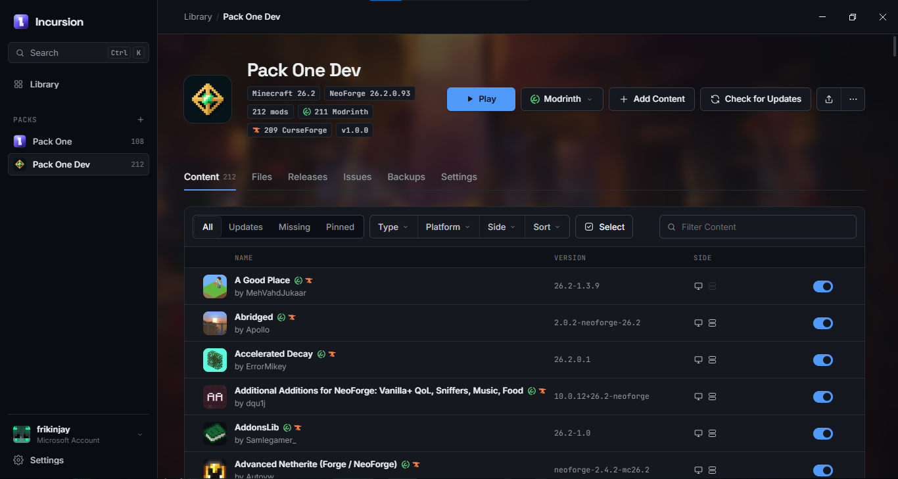

# Incursion

Build one Minecraft modpack and publish it to **CurseForge and Modrinth at the same time**, then play it.

Incursion keeps both platform editions of your pack in sync: every mod is found on both sites, downloaded with
checksum verification and kept up to date, and the pack exports as a CurseForge `.zip`, a Modrinth `.mrpack` and a
server pack.

## Download

Get the latest version from [Releases](https://github.com/frikinjay/incursion/releases/latest):

| System | File |
| --- | --- |
| Windows | `Incursion Setup <version>.exe` |
| macOS | `Incursion-<version>.dmg` (unsigned: right-click the app and choose Open the first time) |
| Linux (Ubuntu, Debian) | `incursion_<version>_amd64.deb`, recommended on Ubuntu 24.04 and newer |
| Linux (other) | `Incursion-<version>.AppImage` |

## Features

- **Both platforms in one pack:** search CurseForge and Modrinth together, with each mod shown once and the platforms
  it is on. Mods are matched across the two sites by their files, links and names, and you can link projects by hand.
- **Mods, resource packs, shaders and data packs**, all checked against your Minecraft version and loader.
- **Updates:** check and install updates for the whole pack or per platform, see each mod's changelog, pin
  versions, and turn mods off without removing them.
- **Releases:** save a release and Incursion writes the changelog for you: added, updated and removed mods, and
  changed config values.
- **Publish** to Modrinth and CurseForge in one step, optionally with a server pack.
- **Play:** sign in with a Microsoft account and launch any pack with its CurseForge or Modrinth files. Mods are
  linked into the game folder, so no extra disk space is used. Several packs can run at once, each with a live
  console.
- **Crash analysis** names the mods most likely responsible; **backups** keep your worlds and configs safe.
- **Import** Modrinth `.mrpack`, CurseForge zips, Prism Launcher and MultiMC instances, packwiz packs, plain mods
  folders and modpack links. **Export** to all of those formats.
- **Community links:** links players make between CurseForge and Modrinth projects are shared anonymously (only the
  two project ids), reviewed, and used by everyone so mods match up better. Turn it off any time in
  Settings → Community Links.

## CurseForge without a key

Incursion works with CurseForge without a personal API key, through the Incursion CurseForge service. A quick
Cloudflare check runs the first time and then about once a month. If you have your own CurseForge API key, add it
in Settings → API Keys and it is used instead.

## Keys and tokens

Only needed for publishing (and optional for browsing). Add them in Settings → API Keys, where each one is checked
before it is saved and stored encrypted with your system's keychain. These environment variables are read too:

| Credential | Used for | Environment variables |
| --- | --- | --- |
| CurseForge API key | Search and downloads (optional) | `CURSEFORGE_API_KEY`, `CF_API_KEY` |
| CurseForge upload token | Publishing to CurseForge | `CURSEFORGE_UPLOAD_TOKEN`, `CURSEFORGE_TOKEN` |
| Modrinth token | Publishing to Modrinth | `MODRINTH_TOKEN`, `MODRINTH_API_KEY`, `MODRINTH_PAT` |

## Building from source

You need [Node.js](https://nodejs.org) 22 or newer.

```bash
npm ci
npm start              # run from source
npm run build          # installer for this system, in dist/
```

Releases are built for Windows, macOS and Linux with GitHub Actions
